# Baysik

Baysik is a BASIC programming environment that runs entirely in your browser. It speaks
the BASIC that shipped with every IBM PC and MS-DOS machine: the line numbered dialect of
GW-BASIC and the structured dialect of QBasic, merged into one language. You write a
program, press F5, and it runs on a real 1980s style screen with the original ROM fonts,
the original screen modes, and a PC speaker. Then you can stop it anywhere, look at every
variable in every procedure on the call stack, change any of them, and carry on.

I learned to program on Logo and then on BASIC, and I wanted something I could hand to a
child, a student, or an old hand who misses the blue screen, without asking anyone to
install DOSBox or find a copy of QBASIC.EXE. Baysik is one HTML file. There is no server,
no account, and no network access. Open it and start typing.

Live at https://baysik.jyotiprakash.org

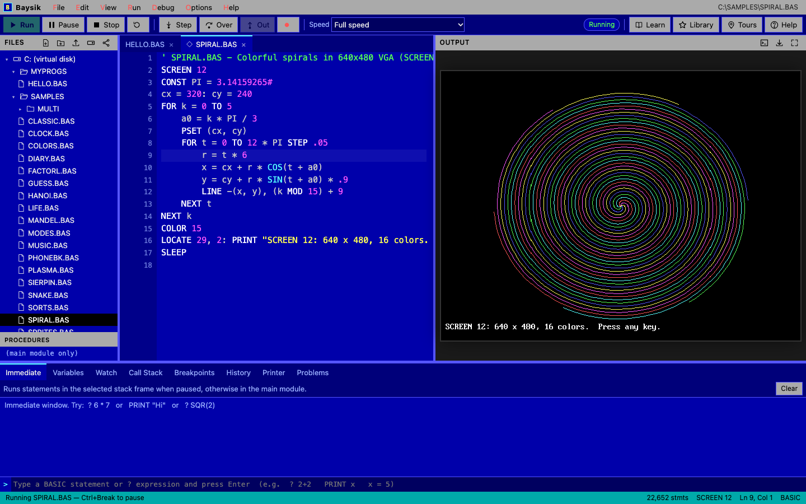

## What you can do with it

Type a program in the editor, or pick one of the five hundred and twenty seven commented
programs in the library, and run it. The output screen behaves like the real thing:
`SCREEN 13` is 320 by 200 with 256 colours, `SCREEN 12` is 640 by 480 with 16, text mode
blinks, `PLAY` plays music, `INKEY$` reads the keyboard, and files you write land on a
small DOS style disk that lives in your browser.

When something goes wrong, or when you simply want to see what a program is doing, you
set a breakpoint, step a statement at a time, and read the state of the machine. The
debugger understands procedures and recursion, so a call to `Factorial(6)` shows six
frames, each with its own `n`. You can hover a variable to see its value, unfold an array
one dimension at a time, drill into a record, and type a new value in place.

If you would rather work the way people did in 1985, the output screen turns into a
GW-BASIC prompt. Type numbered lines, `LIST`, `RUN`, `RENUM`, `SAVE "PROG"`, and use the
soft keys along the bottom row.

For people who are new to programming there is a tutorial of fifty seven lessons, a set of
guided tours of the environment, and a language reference with runnable examples for
every keyword.

## The language

Baysik implements one combined language rather than two separate modes. A program can
use line numbers and `GOSUB` on one line and a `SELECT CASE` inside a `SUB` on the next,
and both behave the way their original interpreter did.

From QBasic it has every statement and function of QBasic 1.1: `SUB` and `FUNCTION` with
parameters passed by reference, recursion, `STATIC` and `SHARED`, `TYPE ... END TYPE`
records, fixed length strings, `CONST`, `DO ... LOOP`, `SELECT CASE`, `DECLARE`, `REDIM`,
`ERASE`, `LBOUND`/`UBOUND`, and `ON ERROR GOTO` with `RESUME`. From QuickBASIC it borrows
the handful of things that make real programs easier: `'$INCLUDE:` metacommands,
`REDIM PRESERVE`, and `ON ERROR RESUME NEXT`.

From GW-BASIC it has line numbers and everything that goes with them: `DEF FN`, `GOSUB`
and `RETURN` to a line, `ON ... GOTO`, `TRON` and `TROFF`, `KEY ON`, `KEY n, "text"`,
`OPEN "O", #1, "FILE"` in the short form, `FIELD` with `LSET` and `RSET`, `MKI$`, `CVI` and
their friends, `CHAIN`, `CHAIN MERGE`, `COMMON`, `MERGE`, `RENUM`, `AUTO`, `DELETE`, and
`EDIT`.

The details are where old programs live or die, so I tried hard to get them right.
`INTEGER` and `LONG` overflow raise `Overflow` where they did. `CINT` rounds half to even.
`SINGLE` arithmetic is single precision. `RND` uses QBasic's own generator, so
`RANDOMIZE 1` gives you the same sequence it gave in 1991. `PRINT` uses fourteen column
zones and prints numbers with their leading space. `PRINT USING` supports the complete
format language. Arrays are stored column major, which matters because `GET` and `PUT`
sprite arrays depend on it.

Events work the way they did: `ON TIMER`, `ON KEY(n)` including user defined keys, `ON
PLAY` for background music, `ON STRIG` for a gamepad, and `ON PEN` driven by the mouse.

## Screens and graphics

All of the PC screen modes that QBasic supported are here at their real resolutions and
with their real colour limits:

| Mode | Resolution | Colours | Adapter |
| --- | --- | --- | --- |
| `SCREEN 0` | 40 or 80 by 25, 43 or 50 lines | 16 with blink | text |
| `SCREEN 1` | 320 by 200 | 4, two CGA palettes | CGA |
| `SCREEN 2` | 640 by 200 | 2 | CGA |
| `SCREEN 3` | 720 by 348 | 2 | Hercules |
| `SCREEN 7` | 320 by 200 | 16, 8 pages | EGA |
| `SCREEN 8` | 640 by 200 | 16, 4 pages | EGA |
| `SCREEN 9` | 640 by 350 | 16 of 64, 2 pages | EGA |
| `SCREEN 10` | 640 by 350 | 4 grey levels | EGA monochrome |
| `SCREEN 11` | 640 by 480 | 2 | VGA |
| `SCREEN 12` | 640 by 480 | 16 of 262,144 | VGA |
| `SCREEN 13` | 320 by 200 | 256 of 262,144 | VGA |

Text is drawn with the IBM ROM fonts at 8 by 8, 8 by 14 and 8 by 16, so the characters
look the way they did, box drawing and all.

`PSET`, `LINE` with boxes and line styles, `CIRCLE` with arcs and aspect ratio, `PAINT` with
tiles, `VIEW`, `WINDOW` and `PMAP` are all supported, and so is the complete `DRAW` macro
language. `GET` and `PUT` use each mode's real memory layout, `PALETTE` and `PALETTE USING`
change colours, and `PCOPY` with active and visual pages gives you flicker free animation.

<p>
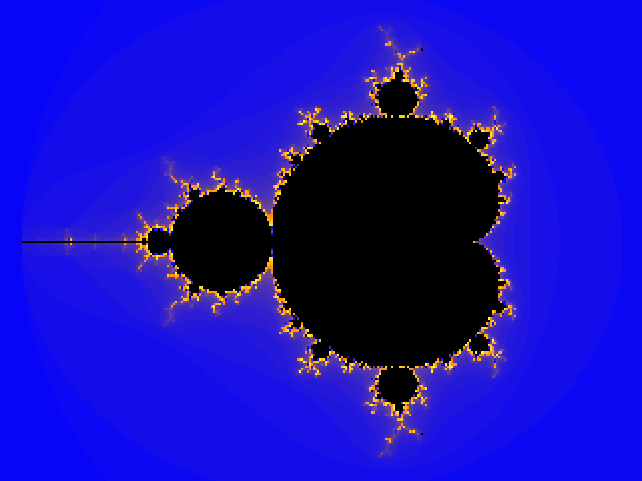
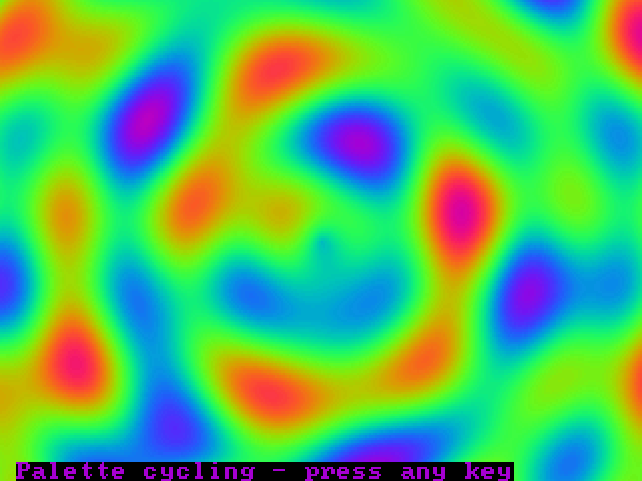
</p>
<p>
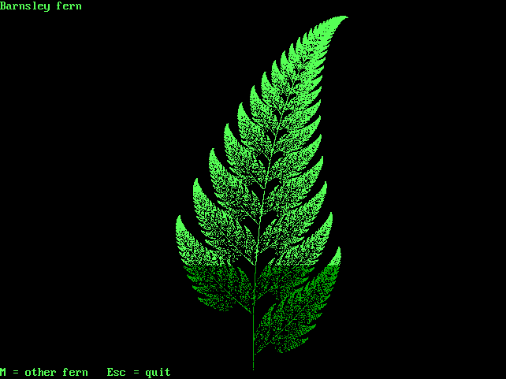
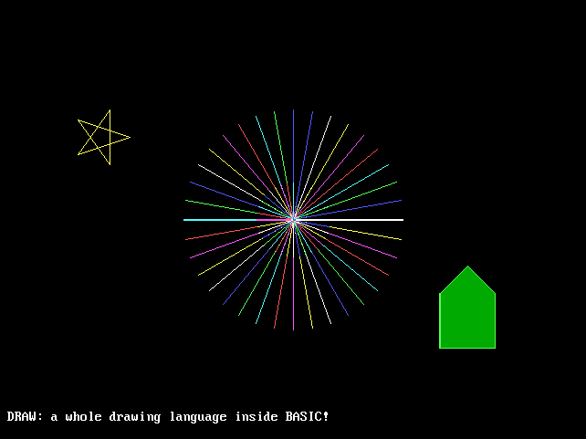
</p>
<p>
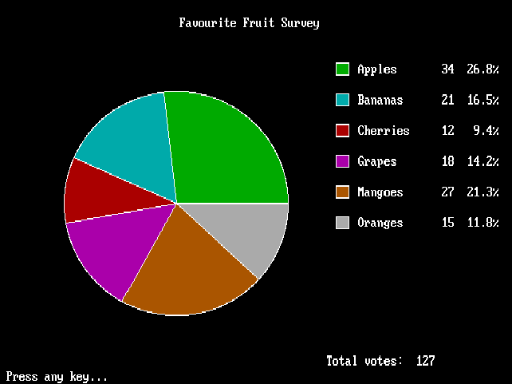
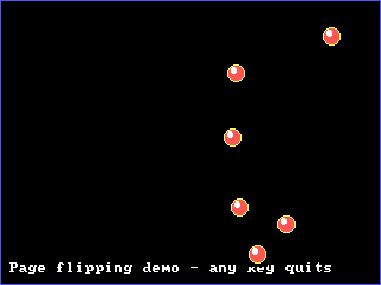
</p>
<p>
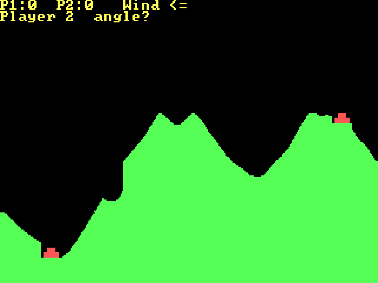
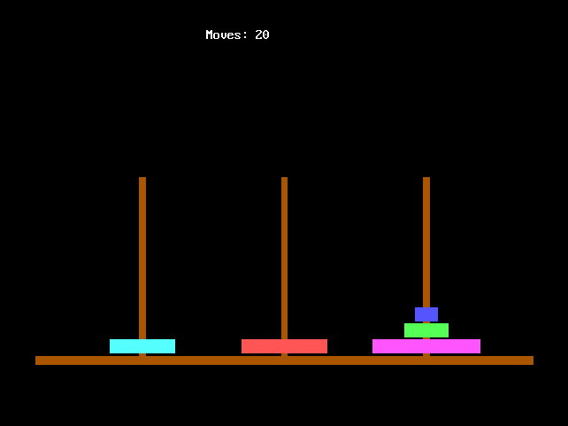
</p>
<p>
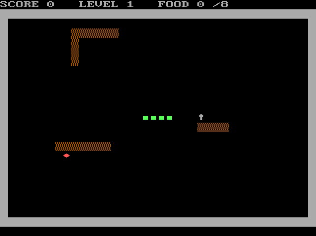
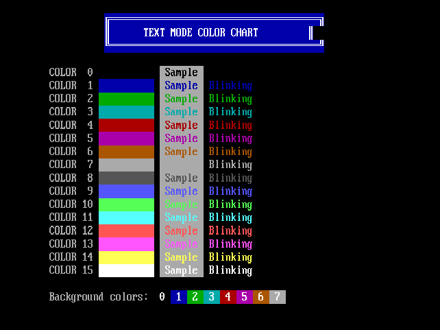
</p>

Programs that poke at the hardware also work. Video memory at `&HB800` and `&HA000` is
real memory you can `PEEK` and `POKE`, the VGA colour registers answer `OUT &H3C8` and
`OUT &H3C9`, port `&H3DA` reports vertical retrace, port `&H60` returns keyboard scan
codes, and the BIOS keyboard flags at `0:417` reflect Shift, Ctrl, Alt and the lock keys.

## Sound

`BEEP`, `SOUND`, and `PLAY` go through the Web Audio API as a square wave, the way the PC
speaker sounded. `PLAY` understands the whole Music Macro Language: notes and rests,
lengths, dotted notes, octaves and `<` `>`, tempo, staccato, legato, numbered notes, and
`MB` for background music that keeps playing while your program runs. Programs that drive
the speaker directly through ports `&H42`, `&H43` and `&H61` are supported too.

## Files and disks

Programs see a DOS style disk. Drive `C:` is a virtual disk stored in your browser, and it
persists between visits. Drive `D:` can be a real folder on your computer that you mount
yourself, and when you mount it you choose whether programs may only read, must ask you
before every write, or may write freely. Programs cannot see anything outside the drives
you give them, paths cannot climb out of a mounted folder, and there are quotas on file
size, disk size and file count.

Sequential files, `RANDOM` files with `TYPE` records or `FIELD`, and `BINARY` files all
work, as do `BLOAD` and `BSAVE`, `KILL`, `NAME`, `MKDIR`, `RMDIR`, `CHDIR` and `FILES`.
The devices `SCRN:`, `KYBD:` and `LPT1:` exist; anything sent to the printer with
`LPRINT` shows up in the Printer panel, where you can save it as a text file.

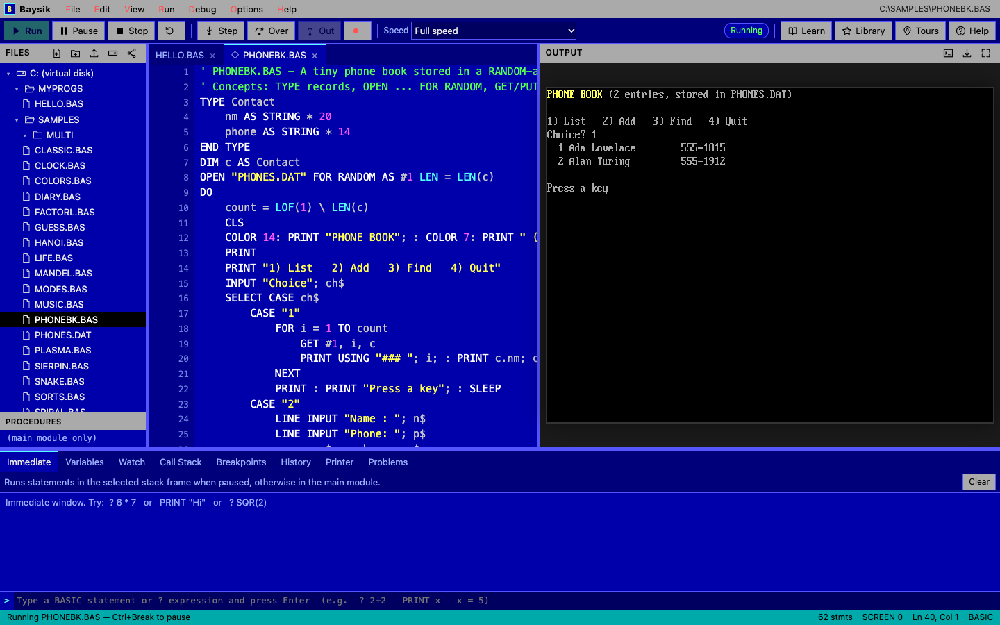

## Bigger programs

A program can be split across several files. `'$INCLUDE: 'SHAPES.BI'` pulls in shared
declarations, `CHAIN "PART2"` hands control to another program with `COMMON` variables
carried across, and `RUN "FILE"` starts another program from scratch. Each folder can have
its own main program, so F5 runs the right thing whichever file you happen to be editing.

## The debugger

This is the part I care about most. Click in the gutter or press F9 to set a breakpoint.
Right click it to make it conditional. A `STOP` statement in the code works as a
breakpoint too. Then use F8 to step into, F10 to step over, Shift+F8 to step out, run to
the cursor, or move the next statement somewhere else entirely.

When the program is paused, the Call Stack panel lists every active `SUB` and `FUNCTION`,
including each level of a recursive call, together with the `GOSUB` return stack and the
`FOR` loops that are open in that frame. Click a frame and the editor jumps to where that
frame is waiting, and the Variables panel shows that frame's locals and parameters,
the module level globals, and the constants.

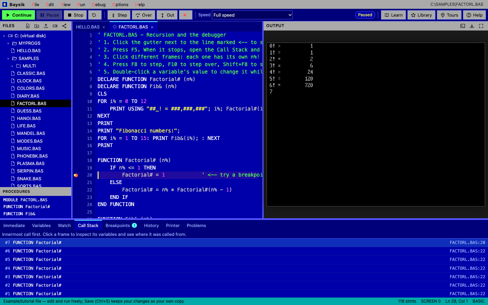

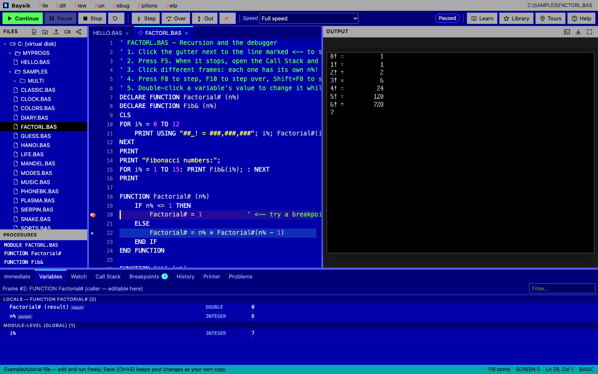

Any value can be changed while you are paused, in any frame. Arrays of any number of
dimensions unfold one dimension at a time, so a three dimensional array shows its planes,
then rows, then cells. Records unfold field by field down to the plain values, including
records inside arrays and arrays of records. Constants are shown but cannot be changed,
because BASIC does not allow it either.

Hovering over a variable in the editor shows the same tree in a small callout. The callout
stays put when you move the mouse into it, so you can unfold things and click a value to
edit it. Edits from the callout apply to the frame you are paused in; the outer frames of a
recursion are edited from the Call Stack and Variables panels. On a touch screen you tap
the variable instead of hovering.

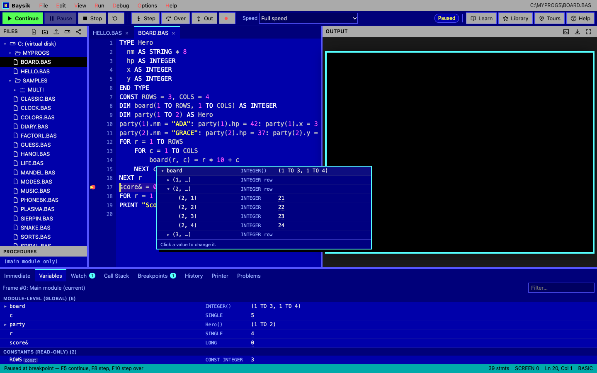

The Watch panel evaluates any expression each time the program stops, and a watch can
be turned into a watchpoint that breaks when its value changes or becomes true. The
Immediate window runs statements in the selected frame while you are paused, or in the
main module otherwise, so `PRINT x`, `x = 5` and `FOR i = 1 TO 3: PRINT i: NEXT` all work
there. The History panel keeps the most recent statements that ran. There is an animate
mode that runs slowly while highlighting each line, `TRON` traces line numbers on screen
like it always did, and a speed control can throttle the machine down to the pace of a
4.77 MHz PC.

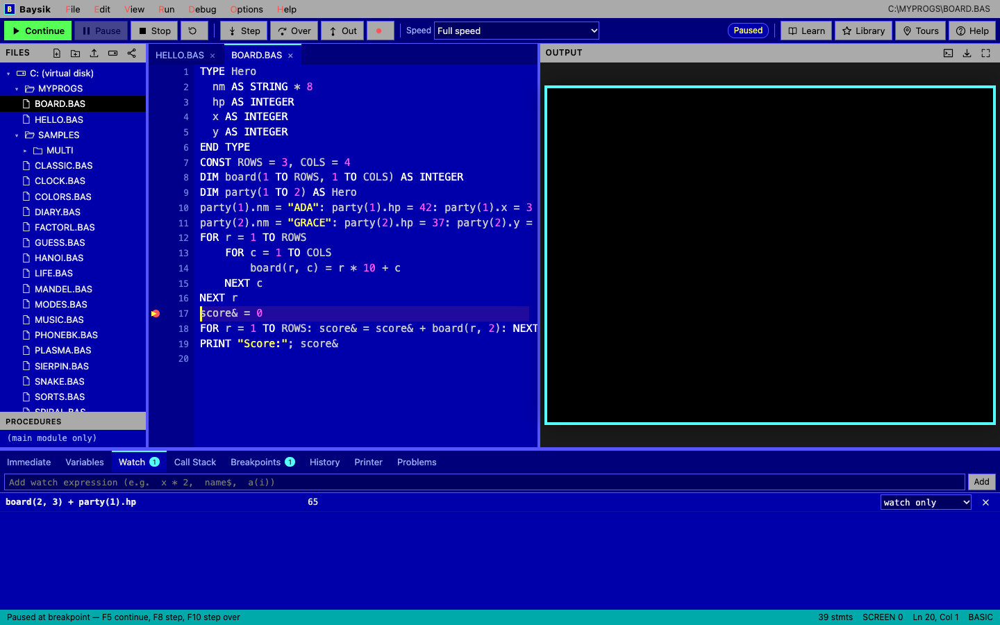

When a program fails, it stops at the failing statement with all of its state intact so
you can look at what went wrong. The message names the error as GW-BASIC would and adds a
plain English hint. Double click an error in the Problems panel or the Immediate log and
the file opens at that line, even if it is an `$INCLUDE` file that was not open.

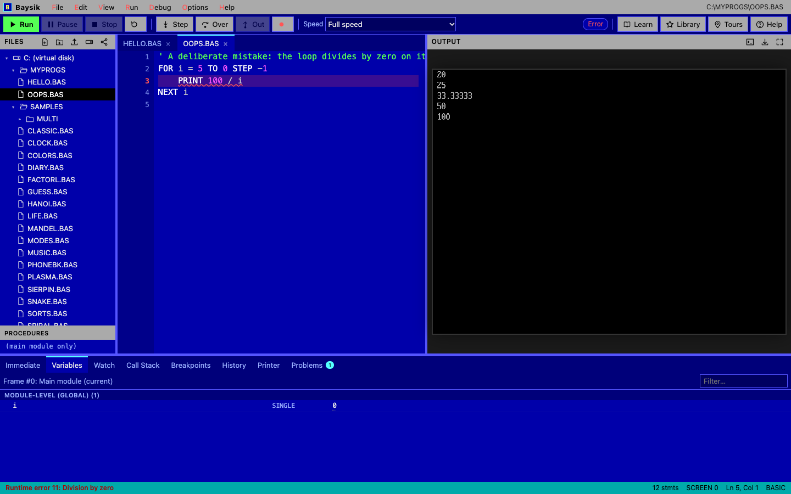

## The GW-BASIC console

View, GW-BASIC Classic Console turns the output screen into the prompt you remember. It
is a full screen editor in the original sense: move the cursor anywhere, change a line,
press Enter, and that line is read back in. `LIST`, `RUN`, `NEW`, `AUTO`, `RENUM`, `EDIT`,
`DELETE`, `CONT`, `LOAD`, `SAVE`, `MERGE`, `FILES` and `SYSTEM` work, and so do F1 to F10.
The program you build at the prompt stays in sync with a file in the editor, so you can
move between the two.

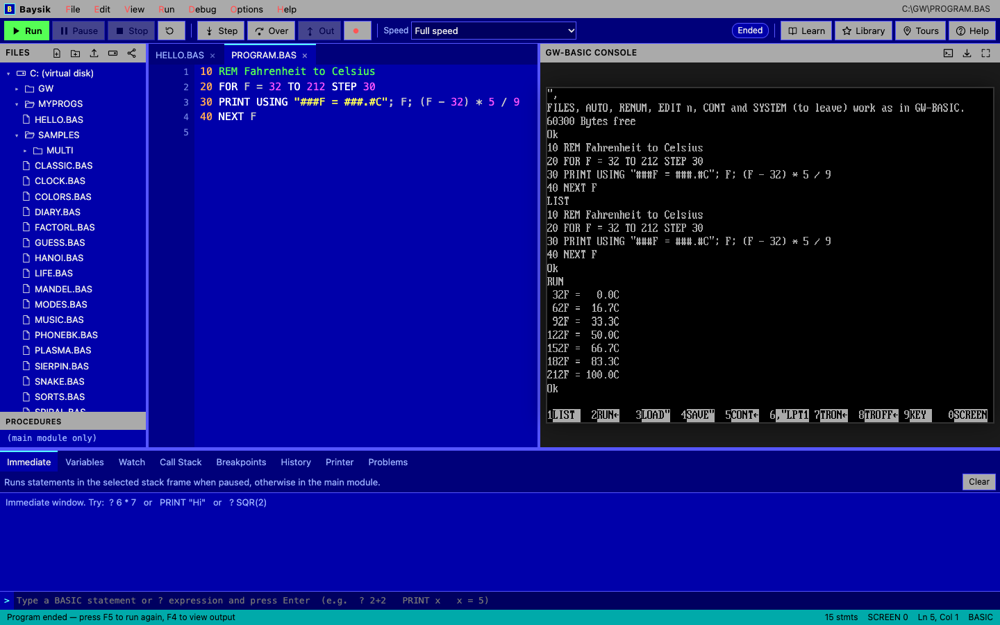

## The program library

The library holds 527 programs in 21 categories: Algorithms, Animation and Sprites,
Business and Finance, Classic GW-BASIC, Codes and Cryptography, Console and Text, Data
Structures, Education and Quizzes, File I/O, Fractals and Generative Art, Games, Graphics,
Mathematics, Music and Sound, Puzzles and Logic, Recursion and Debugging, Science and
Simulation, Strings and Text Processing, System, Events and Hardware, Utilities and Tools,
and Adventure, Stories and AI.

I wrote every one of them by hand. Each starts with a header that says what the program
does, how to use it, which ideas it teaches, and a few things to try changing, and the code
underneath is commented so that you can learn from reading it. They are loaded on demand,
so the library costs nothing until you open it. You can search, filter by level, and open a
program straight into the editor.

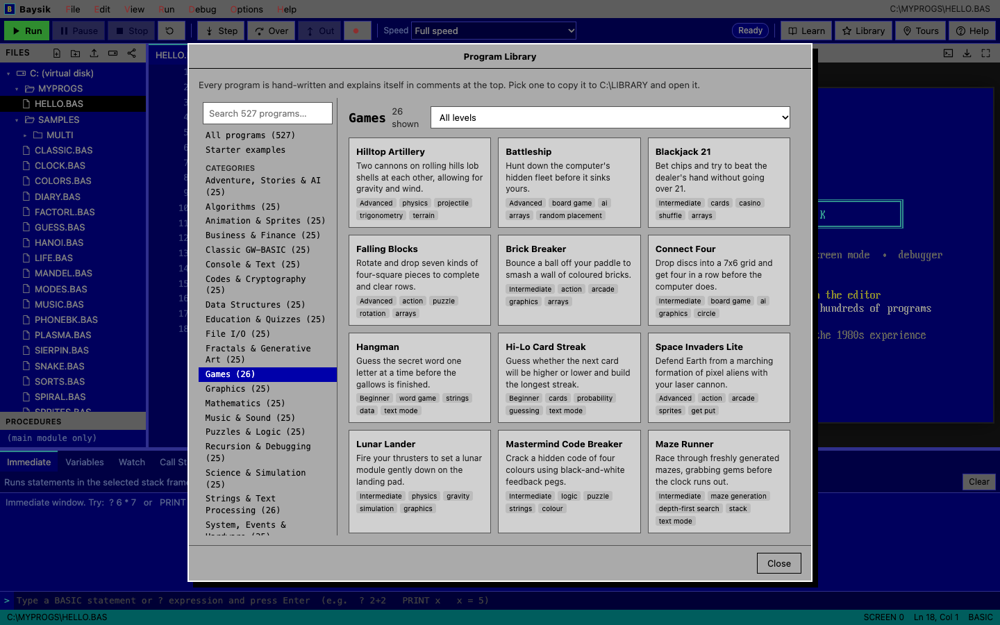

## Learning BASIC

The Learn button opens a tutorial of fifty seven lessons in sixteen units, starting from
"what is a program" and going all the way through procedures, recursion, graphics, sound,
files, the GW-BASIC console and debugging, and ending with a capstone game you build
yourself. It is written so that a ten year old can follow it and an adult who already
programs in something else will not be bored.

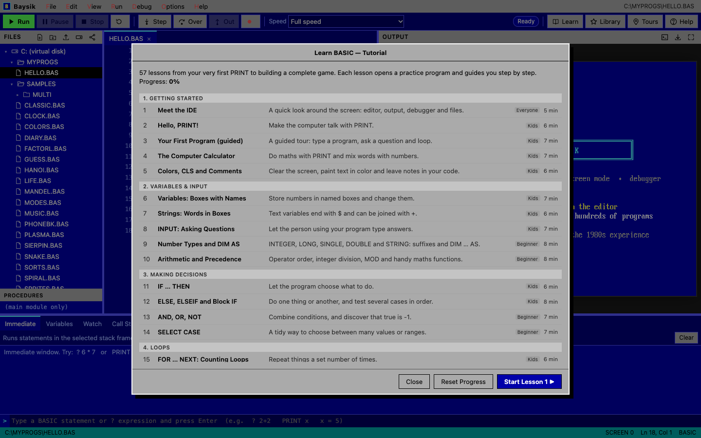

Each lesson is a short guided walk through the real environment. It points at what to look
at, gives you code to type or change, and checks your work as you go, with hints when you
get stuck and a quick quiz at the end. Progress is saved in your browser.

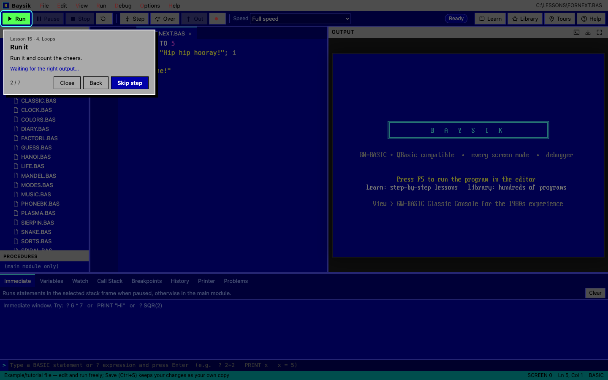

There are also tours of the environment itself: a welcome tour that starts the first time
you open it, and tours for writing your first program, the debugger, graphics and sound,
files and sharing, and the GW-BASIC console.

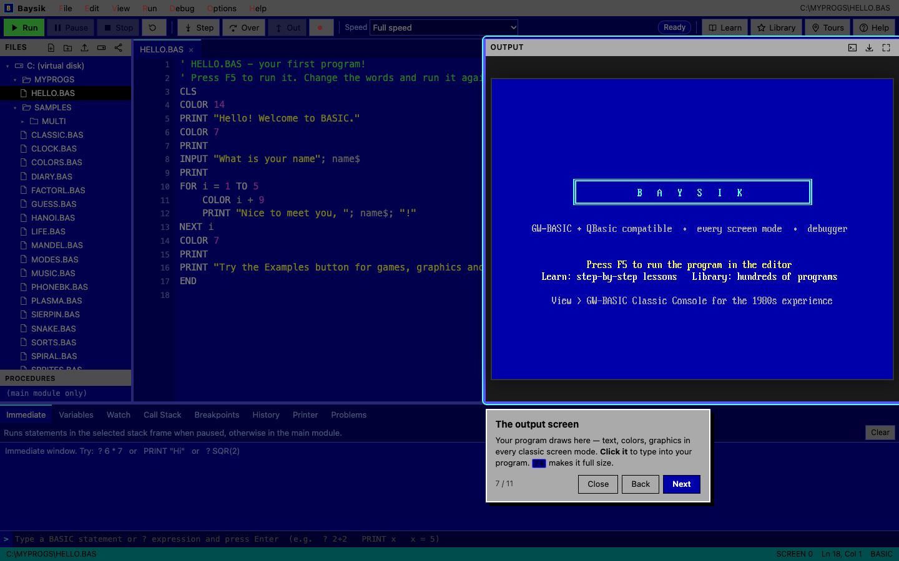

F1 on any keyword opens the language reference at that keyword. Every entry has its
syntax, an explanation, and an example you can run with one click.

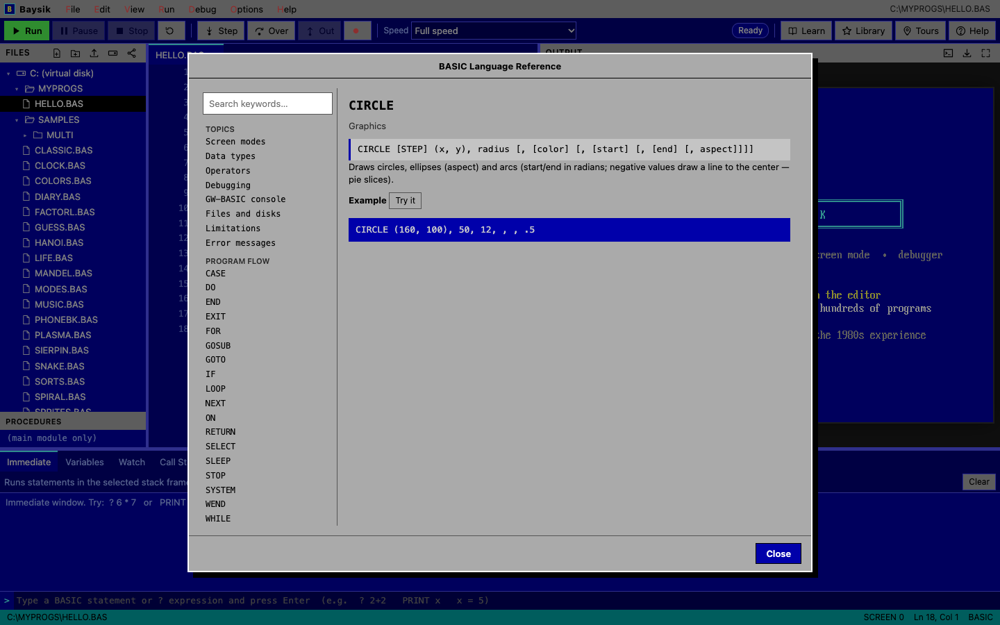

## Sharing

You can share a program or a whole folder as a link. The files are compressed and packed
into the part of the URL after the `#`, which browsers never send to a server, so nothing
is uploaded anywhere. Whoever opens the link gets their own copy to play with. If a link
is too long for where you want to paste it, you can copy the same thing as a block of text
and import that instead. Folders can also be downloaded and uploaded as zip files.

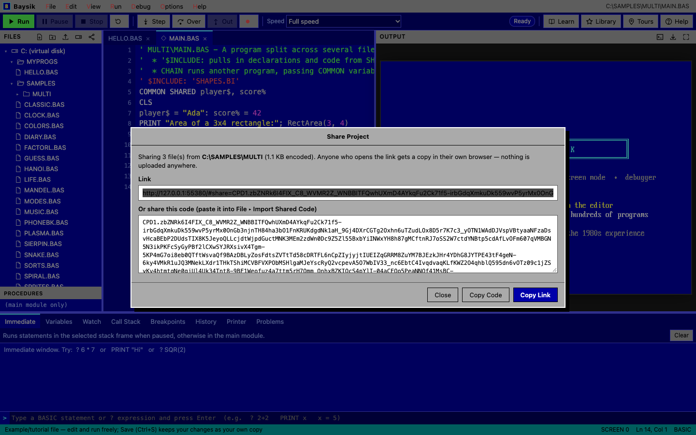

## Your files and the examples

The examples, library programs and lesson files are kept as originals. You can edit and
run them freely, but saving one asks you for a name and saves your own copy, by default in
`C:\MYPROGS`, so the original is always there to go back to. Your own files save in place,
and Save As gives you a copy under a new name. If you close a tab with unsaved changes it
asks whether to save first.

## Themes

There are four themes. QBasic blue is the default, and there are dark, light and amber.

<p>
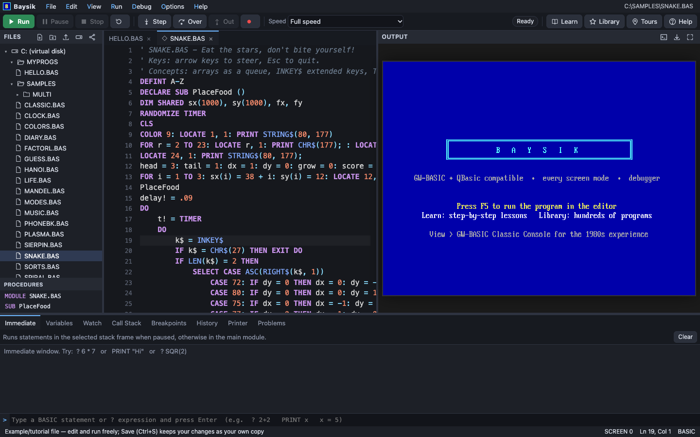
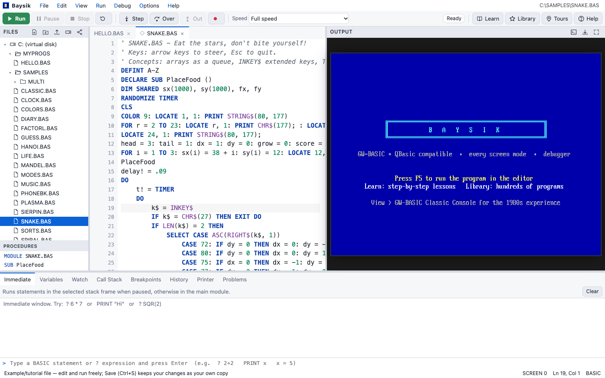
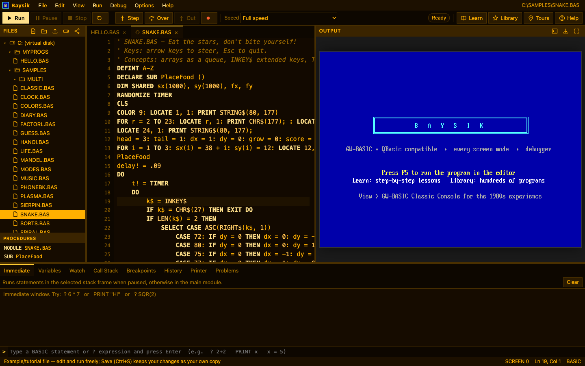
</p>

## Phones and tablets

The layout changes with the size of the screen. On a desktop you get three columns with
splitters you can drag. On a tablet or a small laptop the file list becomes a drawer that
slides in from the side. On a phone you switch between Code, Screen, Debug and Files views
along the top, and the screen fits the width of the phone. On touch devices an on screen
keypad gives you arrow keys, Space, Enter, Esc, Break, and a button that brings up the
keyboard, so games and `INPUT` prompts work without a physical keyboard. Turn a phone
sideways and the keypad moves beside the screen.

<p>
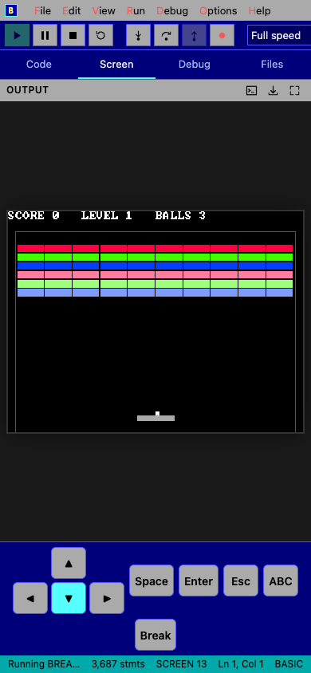
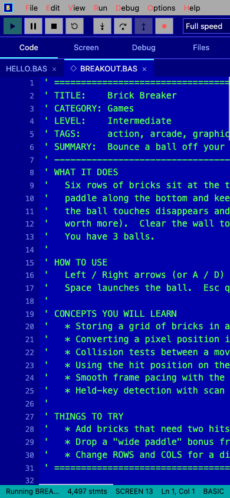
</p>

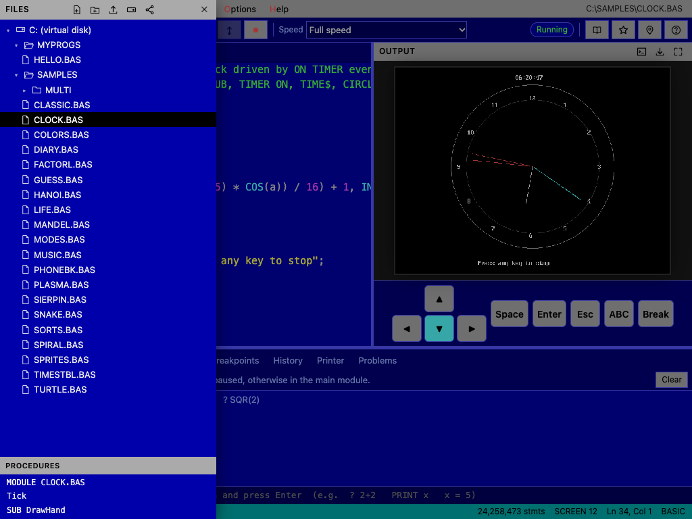

## Running it locally

There is nothing to install. Serve the folder with any static file server, for example

```
python3 -m http.server 8080 --bind 127.0.0.1
```

and open http://127.0.0.1:8080/. Opening `index.html` straight from disk also works,
although browsers will not let a page opened that way mount a real folder as drive `D:`.

To rebuild `index.html` from the sources you need Node 20 or newer, and no packages:

```
npm run build
```

## How it is built

The source lives in `src/` as plain JavaScript with no framework and no dependencies. The
build script reads the sources, packs the sample programs and the compressed library into
data files, and inlines everything into a single `index.html` of a little over two
megabytes, which is what GitHub Pages serves.

The BASIC implementation is a compiler and a virtual machine. The lexer and parser turn
the program into a syntax tree, the compiler turns that into bytecode, and the VM runs the
bytecode with its own explicit frames and value stack. BASIC code never runs on the
JavaScript call stack, which is what makes it possible to pause between any two
statements, to inspect any frame, and to change a value safely. The VM's dispatch loop is
specialised into a flat jump table when the page loads, and in Chrome it runs tens of
millions of BASIC statements a second, so the speed control is there to slow things down
rather than to speed them up.

The display is a set of off screen pixel buffers, one per video page, drawn to a canvas.
Each screen mode is described by its resolution, colour depth, font and memory layout, and
`PEEK`, `POKE`, `GET` and `PUT` all go through the same memory model. The disk is an
in memory file system backed by IndexedDB, with the mounted folder layered on top through
the File System Access API.

## Testing

The project is tested without any manual clicking. `npm test` runs the language tests,
which compile and run BASIC programs and compare their output with the expected
output, along with the debugger tests. The library and the tutorial have
their own checkers, `node tools/check-lib.mjs library` and `node tools/check-lessons.mjs`,
which make sure every program parses and every lesson step points at something real.

The end to end tests under `tests/e2e` drive the real built page in headless Chrome
through the DevTools protocol, with real mouse, keyboard and touch input. There are about
4,400 of them, and between them they cover every menu and shortcut, the editor, files and
persistence, every screen mode, sound and printer output, the whole debugger, the
GW-BASIC console, every step of every tour and every lesson, every library program,
sharing, mounted folders, themes, and the phone and tablet layouts. Any page exception or
console error fails a test.

```
npm test
node tests/e2e/run.mjs
node tests/e2e/run.mjs --spec 50-debug
```

The README screenshots are taken by `node tools/shoot.mjs` from the built page.

## Project layout

```
src/core         fonts, display and screen modes, audio, keyboard, virtual file system
src/lang/basic   lexer, parser, compiler, virtual machine, built in functions,
                 PRINT USING, file I/O, debugger interface, help, lessons
src/ide          editor, runner, panels, console, library, lessons, tours, app
samples          the starter examples on drive C:
library          the program library, one folder per category
assets/fonts     the IBM PC ROM fonts
tests            language and debugger tests, and the headless end to end tests
tools            build helpers, checkers, the Chrome driver, screenshots
```

## Limitations

Some things cannot work in a browser. `CALL ABSOLUTE`, `CALL INTERRUPT` and `USR` run
machine code, so they are not available. There are no serial ports, and `SHELL` only knows a
handful of DOS commands. GW-BASIC's Microsoft Binary Format floating point is replaced by
IEEE, as QBasic did, and `CVSMBF` and `MKSMBF$` are there to convert old data files. Timing
is as close as a browser allows, but a program that depends on the exact speed of a
particular 1980s machine will feel different.

## Trademarks

Microsoft, MS-DOS, GW-BASIC, QBasic, QuickBASIC and Visual Basic are trademarks of
Microsoft Corporation. IBM, IBM PC, PC DOS, CGA, EGA and VGA are trademarks of
International Business Machines Corporation. Hercules is a trademark of its respective
owner. Chrome is a trademark of Google LLC, and GitHub is a trademark of GitHub, Inc. All
other trademarks are the property of their owners. These names are used only to describe
the languages and hardware that Baysik is compatible with. Baysik is an independent
implementation, it contains no code from any of these companies, and it is not affiliated
with or endorsed by any of them.

## License

Baysik is free software under the GNU General Public License, version 3 or later. See
`LICENSE` for the full text and `COPYRIGHT` for the notice.

Under section 7 of the license, there is one additional term, written out in full in
`NOTICE`. Any copy, modification or derived work, including a hosted version, must keep the
attribution "Based on Baysik by Jyotiprakash Mishra (https://baysik.jyotiprakash.org)" in
its source and show it in its about screen or other legal notices. This applies to the
program, the tutorial, and the programs in the library.

Copyright (C) 2026 Jyotiprakash Mishra
